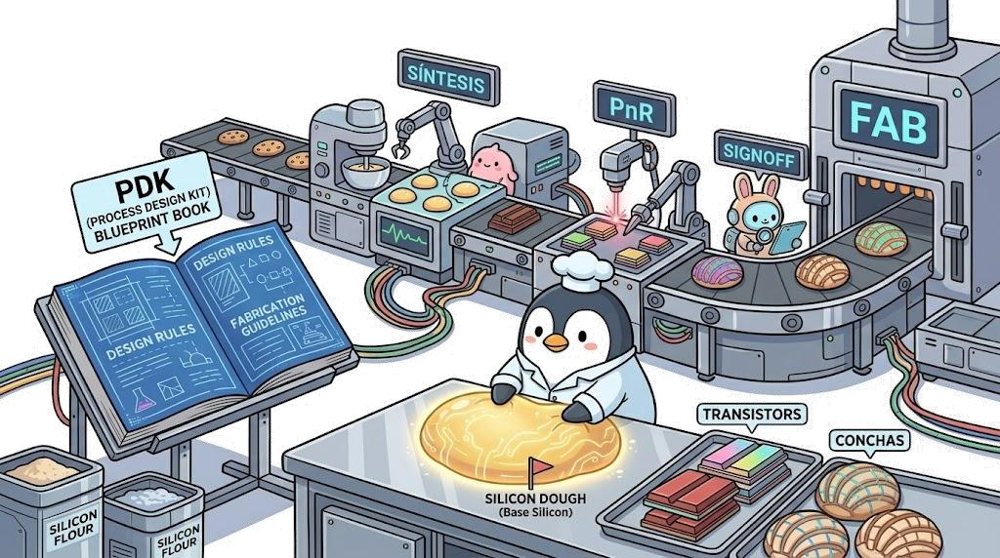

<!-- layout: portada -->
## Curso de 12 h · del RTL al GDSII
# Diseño de un chip, receta completa



<!-- notas:
Bienvenida. En 12 horas vamos a llevar UN solo diseño, el semáforo,
desde el Verilog hasta el GDSII que se manda a la fábrica.
-->

---

<!-- layout: diagrama -->
<!-- color: negro -->
# El flujo de punta a punta


> La salida de cada sesión es la entrada de la siguiente

<!-- notas:
Recorre el diagrama de izquierda a derecha. Front-end en azul (sesiones 2 y 3),
physical design en morado (sesiones 4 a 6): es la mitad del curso.
El PDK alimenta todas las etapas de implementación.
-->

---

<!-- layout: contenido -->
<!-- color: rosa -->
# Reglas del repo del curso

- **Rutas relativas siempre**: el repo corre igual en cualquier máquina
- Cada lab se corre con `make` desde su carpeta
  - `make help` lista los objetivos
- Nada de PDKs, NDA ni resultados pesados en git
- Un solo reloj para todo el curso: **20 ns (50 MHz)**

> Si funciona solo en tu máquina, no funciona

<!-- notas:
Estas reglas se repiten en todos los labs. La del reloj evita el clásico
"en síntesis firmaba y en STA no".
-->

---

<!-- layout: contenido -->
<!-- color: morado -->
# ¿Qué trae un PDK?

| Pieza | ¿Qué es? | ¿A qué etapa alimenta? |
| --- | --- | --- |
| .lib | Timing / potencia de cada celda | Síntesis, STA |
| .lef | Geometría abstracta de cada celda | PnR |
| GDS de la celda | El layout real de cada celda | Ensamble del GDS |
| DRC / LVS decks | Reglas que la fábrica exige | Signoff |
| Corners PVT | Peor / mejor caso | STA |

> Alimenta a todas las etapas siguientes

<!-- notas:
Tabla reutilizada de ParteDigital. En la práctica la vamos a recorrer
carpeta por carpeta dentro de libs.ref/sky130_fd_sc_hd.
-->

---

<!-- layout: codigo -->
<!-- color: verde -->
# Bajar el PDK con ciel

```bash Open Source — ciel
# Versiones disponibles de sky130
ciel ls-remote --pdk-family sky130 | head

# Habilitar una versión en tu carpeta de PDKs
ciel enable --pdk-family sky130 <hash> --pdk-root ~/pdks

# Que el curso lo encuentre
source scripts/env.sh
```

**¿Qué vamos a ver?**

- Estructura de `libs.ref/`
- Una celda por dentro en KLayout

<!-- notas:
POR VALIDAR: flags de ciel en la etiqueta de iic-osic-tools del curso.
Si la red se satura, usar el PDK preinstalado del contenedor.
-->

---

<!-- layout: seccion -->
<!-- color: morado -->
## Capa por capa, como Tres Leches…
# Sesión 5 · Place and Route

> Floorplan → PDN → Placement → CTS → Routing

<!-- notas:
Divisor de sección: marca el inicio del bloque de physical design.
-->

---

<!-- layout: cierre -->
## ¡Gracias!
# ¿Preguntas?

- Repo: `curso-rtl-gds-sky130`
- Próxima sesión: RTL sintetizable y FSM

<!-- notas:
Recordar mandar la captura de la prueba de humo y hacer push de la rama.
-->
