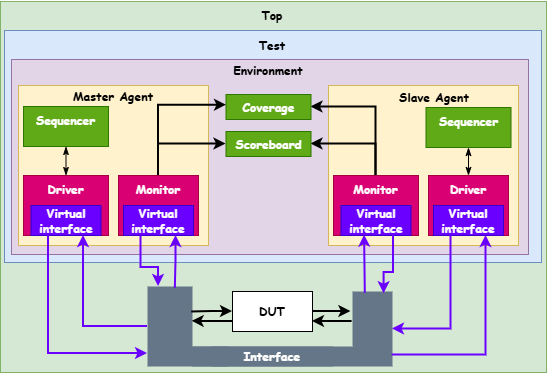
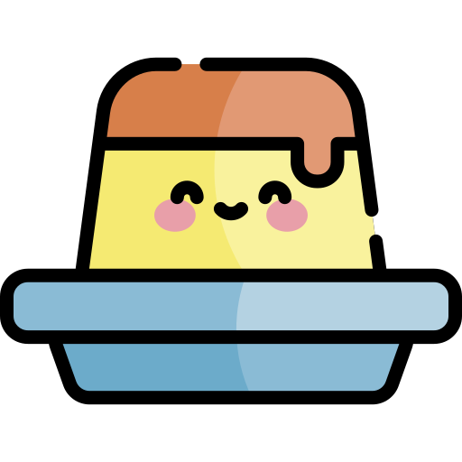
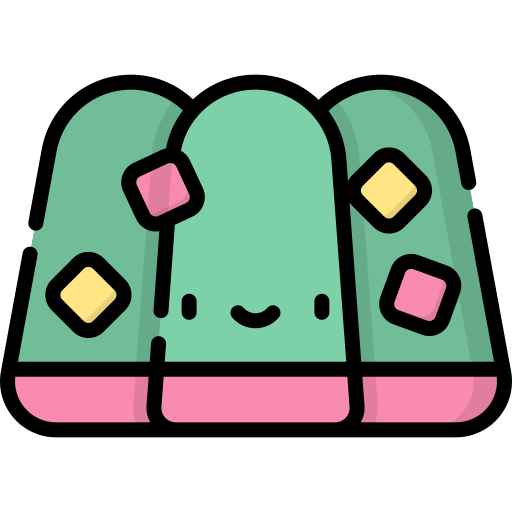
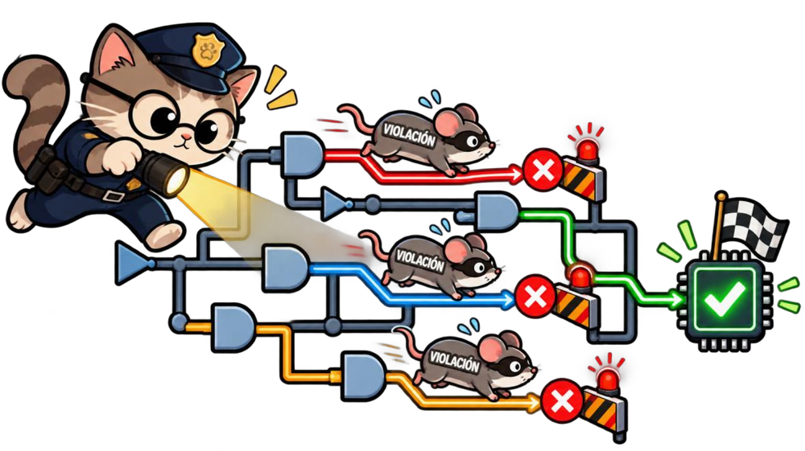

<!-- layout: portada -->
## Rico como Flan Napolitano…
# Sesión 3 · Verificación funcional



<!-- notas:
Hoy probamos el semáforo antes de gastar un peso en silicio. La meta: al salir, cada quien tiene un
testbench que dice PASS/FAIL solo y un test aleatorio en cocotb.
Teoría: 45 min de Flan (verificación funcional) y 10 min de Gelatina (formal). El diagrama de la portada
es un ambiente UVM completo: al final de la sesión van a reconocer cada pieza.
-->

---

<!-- layout: contenido -->
<!-- color: morado -->
# ¿Qué te llevas hoy?

- Un testbench que **se lee solo**: estímulo, checker y PASS/FAIL
- Encontrar el **ciclo exacto** de un bug en la onda (GTKWave)
- Un test **dirigido** y uno **aleatorio** en **cocotb** (Python)
- Saber cuándo parar: **cobertura**
- Saber si tus tests sirven: **mutantes**
- 10 min de **formal**: demostrar en vez de probar

> Entregable: test dirigido y aleatorio en PASS + captura de la onda, en tu rama

<!-- notas:
Recordar dónde estamos: el RTL de la sesión 2 ya tiene ped_req y lint en cero. Hoy no se toca el diseño
(salvo un bug a propósito que se regresa con git restore). Lo que se escribe hoy es el testbench.
-->

---

<!-- layout: seccion -->
<!-- color: negro -->
## Rico como Flan Napolitano…
# Verificación funcional

> Pruebas con la cuchara antes de desmoldar

<!-- notas:
Bloque A, 15 minutos: por qué verificar y cómo es un testbench que no necesita que nadie mire la onda.
-->

---

<!-- layout: contenido -->
<!-- color: verde -->
# ¿Por qué verificar ANTES de fabricar?

- Un chip **no se puede parchar** después de fabricarlo
- Un bug en silicio = **re-spin**: millones de pesos y meses de retraso
- Por eso se prueba en **simulación**, antes de gastar un solo peso en silicio
- La pregunta de esta etapa: **¿el diseño hace lo que la spec pide?**
- Entra el `.v` + un testbench; sale **onda**, veredicto **PASS/FAIL** y **cobertura**

> En la industria, verificar se lleva más de la mitad del esfuerzo de un chip



<!-- notas:
El flan: lo pruebas con la cuchara antes de desmoldarlo. Si tiembla de más, lo arreglas ahora y no frente
a los invitados. En un chip los invitados son los clientes y desmoldar es mandar el GDS a la fábrica.
Dato para la discusión: en equipos grandes hay más ingenieros de verificación (DV) que de diseño.
-->

---

<!-- layout: diagrama -->
<!-- color: cian -->
# ¿Dónde estamos en el flujo?


> Un FAIL hoy cuesta minutos; el mismo bug después del GDS cuesta un re-spin

<!-- notas:
La verificación funcional trabaja sobre el RTL: todavía no hay celdas ni cables. Todo lo que se arregle
aquí no le cuesta nada a las etapas siguientes. Después de la síntesis se vuelve a revisar (equivalencia,
sesión 4) y después del PnR se firma el timing (sesión 6), pero la pregunta "¿hace lo que pide la spec?"
se contesta aquí.
-->

---

<!-- layout: diagrama -->
<!-- color: cian -->
# Anatomía de un testbench

- **Estímulo:** crea los casos de entrada
- **Checker:** compara la salida contra lo esperado
- **Cobertura:** mide cuánto del diseño ya se probó


> Sin checker no hay testbench: hay una película que alguien tiene que ver

<!-- notas:
Las tres piezas existen en cualquier testbench, desde el de 30 líneas del curso hasta un UVM de miles.
El DUT (Design Under Test) es el RTL; el testbench nunca se sintetiza.
Pregunta para el grupo: ¿cuál de las tres piezas falta más seguido en los testbenches de la escuela?
(el checker: se revisa "a ojo" la onda).
-->

---

<!-- layout: codigo -->
<!-- color: verde -->
# Un testbench que se lee solo

```verilog Checker: la regla, en cada flanco
always @(posedge clk)
    if (rst_n && freidora && azucar) begin
        $display("[%0t] FAIL: freidora y azucar a la vez", $time);
        errores = errores + 1;
    end
```

```verilog Estímulo dirigido + veredicto
@(negedge clk) pedido = 1'b1;     // alguien pide churros
@(negedge clk) pedido = 1'b0;
if (!freidora) errores = errores + 1;
...
if (errores == 0) $display(">>> PASS");
else              $display(">>> FAIL: %0d error(es)", errores);
```

- El checker corre **siempre**, en paralelo al estímulo
- El veredicto sale **al final**, sin mirar la onda

<!-- notas:
Ejemplo con la máquina de churros de la sesión 2 (slides/sesion3/ejemplos/tb_churros.v).
El checker es una propiedad de seguridad: algo malo nunca debe pasar. El estímulo cambia las entradas en el
flanco de bajada para no chocar con el flanco de subida, donde el diseño guarda.
El TB del semáforo tiene la misma forma: lo leen en la práctica.
-->

---

<!-- layout: contenido -->
<!-- color: rosa -->
# Mirar la onda no es verificar

- La onda sirve para **entender por qué** falló, no para descubrir **que** falló
- Un humano revisa 50 ciclos; un checker revisa **millones** sin cansarse
- El TB guarda la onda con `$dumpfile` y `$dumpvars` → archivo **VCD**
- En GTKWave: agrega solo las señales que importan, pon el **marcador** en el ciclo y **guarda la vista** (`.gtkw`)
- Cuidado con las unidades: `%t` imprime en la **precisión** del `timescale`

> Primero el FAIL con su tiempo; luego la onda en ese tiempo

<!-- notas:
Flujo de depuración: el checker dice FAIL y el tiempo, abres la onda, vas a ese tiempo y lees el estado,
el contador y las salidas en ese ciclo. File → Reload Waveform recarga la onda sin perder las señales.
Con `timescale 1ns/1ps`, %t imprime en ps: 1 ns = 1000 ps. En la práctica lo van a necesitar.
-->

---

<!-- layout: diagrama -->
<!-- color: cian -->
# El tiempo en la simulación

- El diseño cambia en el flanco de **subida**
- El testbench mueve entradas y lee salidas en el de **bajada**
- Medio ciclo de distancia: nada choca


> Si el TB y el diseño se mueven en el mismo flanco, el resultado depende del simulador

<!-- notas:
Una de las fuentes más comunes de testbenches que "a veces pasan": cambiar una entrada en el mismo instante
en que el flip-flop la muestrea. El orden de eventos en ese instante no está garantizado.
El banco de cocotb de la práctica usa esta misma regla: todo en el flanco de bajada.
Con reloj de 20 ns: el TB actúa a 10 ns del flanco de subida.
-->

---

<!-- layout: seccion -->
<!-- color: negro -->
## Una cucharada no basta
# Dirigida contra aleatoria

> Los bugs viven en los casos que no se te ocurrieron

<!-- notas:
Bloque B, 15 minutos: tipos de estímulo, modelo de referencia, cobertura y mutantes.
-->

---

<!-- layout: contenido -->
<!-- color: verde -->
# Dirigida contra constrained-random

| | Simulación dirigida | Constrained-random |
| --- | --- | --- |
| ¿Quién escribe los casos? | Tú, uno por uno | La herramienta, dentro de reglas |
| ¿Cuántos casos? | Pocos | Miles |
| ¿Qué encuentra? | Lo que imaginaste | Lo que **no** imaginaste |
| ¿Quién revisa? | Tú, caso por caso | Un **modelo** de referencia |
| ¿Cuándo paras? | Cuando se acaba la lista | Cuando la **cobertura** se cierra |

> Las dos se usan: dirigida para arrancar y para bugs puntuales, aleatoria para todo lo demás

<!-- notas:
Constrained-random: aleatorio, pero con reglas (por ejemplo, "el botón no se aprieta durante el reset" o
"los pulsos duran de 1 a 3 ciclos"). Sin reglas, el estímulo genera casos imposibles y los FAIL son falsos.
La semilla hace que lo aleatorio sea repetible: con la misma semilla sale exactamente la misma corrida.
-->

---

<!-- layout: diagrama -->
<!-- color: morado -->
# ¿Quién revisa lo aleatorio? El modelo

- Con miles de casos al azar, nadie puede escribir el "esperado" a mano
- Un **modelo de referencia** hace lo mismo que el RTL, pero simple y en alto nivel
- El **comparador** revisa el diseño contra el modelo en cada ciclo


> En UVM al comparador se le llama scoreboard

<!-- notas:
El modelo no se sintetiza: puede ser lento, usar diccionarios y strings, lo que sea. Lo importante es que
lo escriba alguien que leyó la spec, de preferencia no la misma persona que escribió el RTL: si los dos
entienden mal la spec igual, el comparador no ve nada.
En la práctica el modelo ya viene hecho en el banco de cocotb; ustedes escriben el estímulo.
-->

---

<!-- layout: contenido -->
<!-- color: amarillo -->
# Cobertura: ¿cuándo paramos?

- La cobertura **funcional** cuenta situaciones de la spec: *¿llegamos ahí?*
- En la máquina de churros: pedido en ESPERA, pedido mientras se fríe, reset a medio freír…
- Cada situación es un **bin**; el test falla si un bin se queda en cero
- La cobertura **no** dice si el diseño está bien: dice si **probaste**
- Un estímulo puede correr un millón de ciclos y no probar nada

> Cobertura: "¿pasé por ahí?"

<!-- notas:
También existe la cobertura de código (líneas, ramas, toggles), que da el simulador sola. La funcional la
escribe el DV Engineer a partir del plan de verificación.
Ejemplo para pensar: un test aleatorio que nunca aprieta un botón puede dar PASS siempre. La tabla de
cobertura es la que lo delata. En la práctica lo van a ver pasar paso a paso.
-->

---

<!-- layout: diagrama -->
<!-- color: rosa -->
# ¿Quién prueba al testbench? Mutantes

- Un test que no revisa nada **también** dice PASS
- Un **mutante** es una copia del diseño con **un** bug a propósito
- Si tu test dice FAIL, lo atrapó; si dice PASS, tu test tiene un **hueco**


> Cobertura: "¿pasé por ahí?" · Mutantes: "¿me habría dado cuenta?"

<!-- notas:
En la industria: mutation testing, fault injection o bug seeding. Synopsys lo vende como Certitude
(functional qualification): mete fallas en el RTL de forma automática y dice cuáles no detecta el
testbench UVM. No es lo mismo que el checker (eso es lo que se pone a prueba) ni que connectivity checking
(una app formal para conexiones entre bloques de un SoC).
Ejemplo con churros: un mutante donde el azúcar dura dos ticks. ¿Lo atrapa test_un_pedido? (sí: revisa que
regrese a ESPERA). ¿Y uno donde "listo" se ignora mientras hay pedido? Depende del estímulo.
En la práctica, make mutantes corre sus tests contra varios mutantes.
-->

---

<!-- layout: seccion -->
<!-- color: negro -->
## La liga profesional
# UVM y cocotb

> Los mismos conceptos, a escala de chip real

<!-- notas:
Bloque C, 15 minutos: los frameworks y cocotb en concreto, que es lo que usan en la práctica.
-->

---

<!-- layout: contenido -->
<!-- color: morado -->
# UVM y cocotb

| | UVM | cocotb |
| --- | --- | --- |
| Lenguaje del testbench | SystemVerilog | Python |
| Simuladores | VCS, Questa, Xcelium | Icarus, Verilator, VCS, Questa… |
| Dónde se usa | La mayoría de la industria | Startups, open source, academia |
| Lo fuerte | Estándar, reutilización, constraints | Rápido de escribir, todo el ecosistema de Python |

- Las piezas son las mismas: **driver** (estímulo), **monitor**, **scoreboard** (comparador) y **coverage**


<!-- notas:
El diagrama es el de la portada: sequencer + driver generan el estímulo, el monitor observa, el scoreboard
compara contra el modelo y coverage cuenta. En cocotb no hay clases obligatorias: se escribe con funciones
y corutinas de Python, pero las responsabilidades son las mismas.
Para quien quiera seguir: el curso de UVM con VCS del laboratorio usa exactamente esta estructura.
-->

---

<!-- layout: diagrama -->
<!-- color: morado -->
# Un ambiente UVM, pieza por pieza


> Separar QUÉ (sequence) de CÓMO (driver) es lo que permite reutilizar

<!-- notas:
Cada pieza tiene una responsabilidad: el test solo elige secuencias, el monitor no juzga (observa y
publica) y scoreboard y cobertura escuchan al monitor.
Es el mismo diagrama de la portada, ahora con nombres. Recorrerlo con el flujo de un dato: la secuencia crea
un item ("pedido = 1"), el sequencer se lo pasa al driver, el driver lo pone en los pines en el flanco de
bajada, el DUT responde, el monitor convierte pines en un item y lo publica por un analysis port; el
scoreboard lo compara contra el modelo y la cobertura lo cuenta.
Reutilización: el mismo agent sirve en el ambiente del bloque y en el del chip completo (ahí el driver se
apaga y solo queda el monitor: agent pasivo). Las empresas compran agents hechos (VIP) para AXI, PCIe, USB.
-->

---

<!-- layout: contenido -->
<!-- color: morado -->
# Lo mismo que ya conoces, con otro nombre

| Pieza UVM | Qué hace | En el banco de cocotb del lab |
| --- | --- | --- |
| `sequence_item` | Lo que pasa en un ciclo | Los argumentos de `tb.pulso()` / `tb.reset()` |
| `sequence` | Genera el estímulo (dirigido o aleatorio) | Tu test |
| `driver` | Item → pines, en el flanco correcto | `tb.pulso()`, `tb.reset()` |
| `monitor` | Pines → item | Las lecturas de `tb.luz()` |
| `scoreboard` | Modelo + comparador | El modelo y el comparador del banco |
| `coverage` | Covergroups: ¿qué alcanzamos? | La tabla de cobertura de `tb.cierra()` |
| `test` | Elige secuencias y configuración | `@cocotb.test()` |

> UVM no inventa conceptos nuevos: los pone en clases estándar que todo el mundo entiende

<!-- notas:
Esta tabla es el puente: lo que hacen en la práctica con cocotb es un UVM chiquito. Cuando lleguen a una
empresa, el código cambia de lenguaje pero las responsabilidades son las mismas.
Diferencia real: en UVM todo es una clase registrada en la factory, con fases y configuración por
uvm_config_db. Eso da reutilización a escala de cientos de ingenieros, a cambio de mucho código.
-->

---

<!-- layout: codigo -->
<!-- color: cian -->
# La transacción y el constrained-random

```systemverilog churros_item.sv
class churros_item extends uvm_sequence_item;
    rand bit rst_n, pedido, listo;     // entradas: las genera la secuencia
    bit      freidora, azucar;         // salidas: las llena el monitor

    constraint c_reset  { rst_n  dist {1 := 19, 0 := 1}; }
    constraint c_pedido { pedido dist {1 := 3,  0 := 7}; }

    `uvm_object_utils(churros_item)    // registrado en la factory
    ...
endclass
```

```systemverilog Una secuencia dirigida: las mismas reglas, con with
`uvm_do_with(req, { rst_n == 1; pedido == 1; listo == 0; })
```

- `rand` + `constraint`: aleatorio **con reglas**
- `dist`: con qué probabilidad sale cada valor
- `with { }`: fija valores para un caso dirigido

<!-- notas:
Aquí está la fuerza de SystemVerilog para verificación: el solver de constraints. Una regla como
"rst_n vale 0 una de cada 20 veces" se escribe en una línea; con reglas entre campos (por ejemplo,
"si es escritura, la dirección debe estar alineada") el solver encuentra valores que cumplen todo.
En cocotb lo mismo se hace a mano con random.random() o con librerías como cocotb-coverage / pyuvm.
-->

---

<!-- layout: codigo -->
<!-- color: cian -->
# Driver y monitor: entrar y salir de los pines

```systemverilog churros_driver.sv · run_phase
forever begin
    seq_item_port.get_next_item(req);   // pide el siguiente item
    @(negedge vif.clk);                 // en la bajada: nada choca
    vif.pedido <= req.pedido;
    vif.listo  <= req.listo;
    seq_item_port.item_done();
end
```

```systemverilog churros_monitor.sv · run_phase
forever begin
    @(vif.mon_cb);                      // clocking block
    t.pedido   = vif.mon_cb.pedido;
    t.freidora = vif.mon_cb.freidora;   ...
    ap.write(t);                        // a quien esté escuchando
end
```

- El driver **no decide** qué valor poner: solo el **cuándo** y el **dónde**
- El `clocking block` muestrea sin carreras contra el flanco

<!-- notas:
vif es una virtual interface: el puente entre el mundo de clases (dinámico) y el de módulos (los pines).
El top la registra con uvm_config_db y el driver y el monitor la piden en build_phase.
El clocking block con "input #1step" toma el valor de justo antes del flanco de subida: es la manera
estándar de evitar las carreras de las que hablamos en la slide del tiempo en la simulación.
-->

---

<!-- layout: codigo -->
<!-- color: verde -->
# Scoreboard y cobertura: el juez y el contador

```systemverilog churros_scoreboard.sv · write()
if (t.freidora !== (modelo == FREIR) || t.azucar !== (modelo == AZUCAR))
    `uvm_error("SCB", $sformatf("en %s: freidora=%0b azucar=%0b",
               modelo.name(), t.freidora, t.azucar))
case (modelo)                           // el modelo avanza con las entradas
    ESPERA: if (t.pedido) modelo = FREIR;
    FREIR:  if (t.listo)  modelo = AZUCAR;
    AZUCAR:               modelo = ESPERA;
endcase
```

```systemverilog churros_coverage.sv
covergroup cg;
    cp_salida : coverpoint {t.freidora, t.azucar} iff (t.rst_n) {
        bins espera = {2'b00};  bins freir = {2'b10};  bins azucar = {2'b01};
        illegal_bins dos = {2'b11};     // freír y azúcar a la vez
    }
    x_pedido : cross cp_salida, cp_pedido;   // ¿pidieron en cada estado?
endgroup
```

- `uvm_error` suma al contador: al final, **TEST PASSED / FAILED** sale solo
- `cross`: combinaciones de situaciones; `illegal_bins`: lo que nunca debe pasar

<!-- notas:
El modelo del scoreboard es el mismo que el de test_churros.py en Python: unas líneas que cualquiera puede
revisar contra la spec. El scoreboard nunca usa las señales internas del DUT, solo lo que ve el monitor.
La cobertura funcional sale en el reporte del simulador (URG en VCS) y se junta de todas las semillas de la
regresión: así se sabe cuándo el plan de verificación está cerrado.
-->

---

<!-- layout: diagrama -->
<!-- color: morado -->
# Fases y objections: quién manda en el tiempo

- Todos los componentes pasan por las **mismas fases**, en orden
- La simulación termina cuando nadie tiene una **objection** levantada
- `+UVM_TESTNAME=churros_random_test` elige el test **sin recompilar** (factory)


> Una vez compilado, un ambiente UVM corre cientos de tests distintos

<!-- notas:
build_phase va de arriba hacia abajo (el test crea el env, el env crea el agent...), connect_phase conecta
puertos, run_phase es la única que consume tiempo y report_phase imprime resúmenes.
El test levanta una objection antes de arrancar las secuencias y la baja al terminar. Error clásico: olvidar
el raise y que la simulación termine en el tiempo 0 con PASSED (no se probó nada).
La factory permite además cambiar una clase por otra desde el test (type override) sin tocar el env.
-->

---

<!-- layout: diagrama -->
<!-- color: rosa -->
# Así se verifica en la industria

- Un **plan de verificación** sale de la spec: qué hay que probar y cómo se mide
- Cada noche corre la **regresión**: todos los tests, con miles de semillas
- Cada FAIL se **repite con su semilla** y se decide: ¿bug del RTL o del testbench?
- Se firma cuando la **cobertura se cierra** y no queda ningún FAIL


<!-- notas:
Datos para la discusión: en un SoC grande la regresión usa granjas de cientos de servidores y licencias de
simulador; un DV Engineer pasa buena parte del día en triage de fallas. Herramientas típicas: VCS o Xcelium
para simular, Verdi para depurar, URG/IMC para cobertura, vManager o VC Execution Manager para regresiones.
Certitude (mutantes) entra al final para preguntar si el testbench de verdad vería un bug.
Rol: DV Engineer. Es la puerta de entrada más común a la industria de semiconductores en México.
-->

---

<!-- layout: codigo -->
<!-- color: negro -->
# Demo: UVM con VCS

```bash Synopsys — VCS + UVM 1.2
cd slides/sesion3/ejemplos/uvm_churros/sim
make regress                  # dirigido + 3 aleatorios + URG
make sim TEST=churros_random_test SEED=7
make bug                      # mismos tests, RTL con bug
make verdi                    # cobertura en Verdi
```

- `make regress`: los 4 tests con **TEST PASSED** y el % de cobertura
- `make bug`: el **dirigido pasa**; el **aleatorio** da `UVM_ERROR [SCB]`
- El log dice la **semilla**: con ella se repite la falla exacta

<!-- notas:
Demo en vivo, 8 a 10 minutos, en la máquina con licencia de VCS (no en el contenedor de los alumnos).
El bug de rtl_bug/maquina_churros_bug.v: si llega "listo" mientras alguien sigue pidiendo, la máquina no
pasa al azúcar. El test dirigido nunca pide y avisa "listo" en el mismo ciclo, así que no lo ve; el aleatorio
lo encuentra en pocos ciclos. Es la lección de dirigida contra aleatoria, con herramientas de la industria.
Después de make bug: abrir el log, buscar el primer UVM_ERROR, leer el tiempo y repetir con la misma semilla.
Para la onda: make compile FSDB=1 y make sim, luego verdi -ssf churros.fsdb.
-->

---

<!-- layout: contenido -->
<!-- color: verde -->
# Qué buscar en el log de UVM

- `UVM_INFO ... [SCB] 300 ciclos revisados, 0 errores`: el juez trabajó
- `UVM_INFO ... [COV] cobertura funcional: ...%`: cuánto del plan alcanzamos
- `UVM_ERROR ... [SCB] en FREIR: ...`: **qué** falló, **dónde** y **cuándo**
- `--- UVM Report Summary ---`: el conteo de INFO, WARNING, ERROR y FATAL
- `*** TEST PASSED ***` solo si `UVM_ERROR` y `UVM_FATAL` están en **cero**

> Un buen testbench se diagnostica leyendo el log, no la onda

<!-- notas:
Mostrar el log real de la demo junto a esta slide. El reporte final de UVM siempre trae el resumen por
severidad y por ID ([SCB], [COV], [TEST]): en una regresión, un script lee esas líneas de miles de logs y
arma la tabla de PASS/FAIL. Es lo mismo que hace make entrega en el lab, pero a escala.
-->

---

<!-- layout: codigo -->
<!-- color: cian -->
# cocotb en 20 líneas

```python Python — cocotb 2.x
import cocotb
from cocotb.clock import Clock
from cocotb.triggers import FallingEdge

@cocotb.test()
async def test_un_pedido(dut):
    Clock(dut.clk, 20, unit="ns").start(start_high=False)
    dut.rst_n.value = 0
    await FallingEdge(dut.clk)
    dut.rst_n.value = 1
    dut.pedido.value = 1                 # alguien pide churros
    await FallingEdge(dut.clk)
    dut.pedido.value = 0
    assert dut.freidora.value == 1, "no prendió la freidora"
```

- `@cocotb.test()` marca un test
- `await` espera tiempo de simulación
- `.value =` escribe; `.value` lee
- `assert` con mensaje: el FAIL se explica solo

<!-- notas:
El simulador (Icarus) corre el Verilog; cocotb corre el Python y se comunican por VPI.
cocotb 2.x cambió varias cosas respecto a ejemplos viejos de internet: Clock usa unit= (antes units=),
ya no existe el "<=" para escribir señales (se usa .value =) y el runner vive en cocotb_tools.
Si copian un ejemplo de internet y no corre, casi siempre es eso.
Archivo completo: slides/sesion3/ejemplos/test_churros.py (dirigido y aleatorio con modelo).
-->

---

<!-- layout: contenido -->
<!-- color: verde -->
# Lo que más se olvida en cocotb

- **`await`** antes de todo lo que espera: sin él, la corrutina nunca corre
- Mover entradas y leer salidas en el flanco de **bajada**
- La **semilla** sale en el log: con ella repites exactamente una corrida que falló
- Python usa la **sangría**: 4 espacios por nivel, sin mezclar tabs
- Un `assert` sin mensaje dice FAIL, pero no **por qué**

> RuntimeWarning: coroutine ... was never awaited = te faltó un await

<!-- notas:
Estos cinco errores cubren casi todo lo que vimos en la validación de la práctica.
IndentationError: el cuerpo de un for va 4 espacios más adentro que el for.
En make, las variables van pegadas: SEED=7, no SEED = 7.
-->

---

<!-- layout: codigo -->
<!-- color: rosa -->
# Hagamos un ejemplo…

```bash Open Source — Icarus, GTKWave y cocotb
iverilog -g2012 -o sim maquina_churros.v tb_churros.v
vvp -n sim
gtkwave churros.vcd &
python3 run_churros.py        # cocotb, SIM=icarus
```

```bash Comercial — Synopsys
vcs -full64 -sverilog maquina_churros.v tb_churros.v -o simv
./simv
vcd2fsdb churros.vcd -o churros.fsdb
verdi -ssf churros.fsdb &
```

- Como **DV Engineer** armas el plan de verificación y persigues cerrar la cobertura

<!-- notas:
Demo en vivo con slides/sesion3/ejemplos: TB autoverificable con PASS, la onda en GTKWave y los dos tests de
cocotb en PASS. Del lado comercial, VCS simula y Verdi muestra la onda (FSDB); en UVM, VCS corre el mismo
ambiente con +UVM_TESTNAME. cocotb también funciona con VCS cambiando el simulador del runner.
-->

---

<!-- layout: portada -->
## Raro como gelatina de mosaico…
# Verificación formal



<!-- notas:
Bloque D, 10 minutos. Solo la idea y un ejemplo; en la práctica es la parte 4, opcional.
La gelatina de mosaico: o toma la forma exacta del molde… o no cuaja.
-->

---

<!-- layout: diagrama -->
<!-- color: morado -->
# Probar casos contra demostrar

- **Flan:** pruebas los casos que se te ocurren; si no visitaste un caso, no sabes qué pasa ahí
- **Gelatina:** la herramienta demuestra que la propiedad se cumple para **todos** los casos, o te da un **contraejemplo**
- No necesitas estímulo: necesitas decir la **propiedad**


<!-- notas:
La gelatina de mosaico: piezas rígidas y transparentes que encajan con precisión. O toma la forma exacta del
molde o no cuaja: sin medias tintas. Formal es igual: PASS es una demostración, no "no encontré nada".
-->

---

<!-- layout: codigo -->
<!-- color: amarillo -->
# ¿Qué es una propiedad?

```verilog Envoltorio formal: entradas libres + la regla
module formal_churros (input clk, rst_n, pedido, listo);
    maquina_churros dut (...);         // el mismo RTL, sin tocarlo

    always @(posedge clk) begin
        if (!f_started) assume (!rst_n);   // arranca con reset
        else            assume ( rst_n);
    end

    always @(posedge clk)
        if (f_started && rst_n)
            assert (!(freidora && azucar));    // NUNCA las dos
endmodule
```

- `assume`: lo que el solver **puede dar por hecho**
- `assert`: la ley que el solver intenta **romper**
- Las entradas sin `assume` son **libres**: cualquier valor, en cualquier ciclo

<!-- notas:
En simulación, el checker era un if que a veces se ejecuta; en formal es una ley que la herramienta intenta
romper por todos los medios. Ojo con los assume: si son demasiado fuertes, prohíben justo el caso del bug y
la prueba pasa sin demostrar nada (el equivalente formal de un test vacío).
Archivo completo: slides/sesion3/ejemplos/formal_churros.v y churros.sby.
-->

---

<!-- layout: contenido -->
<!-- color: cian -->
# BMC, inducción y el contraejemplo

- **BMC** (bounded model checking): busca, ciclo a ciclo, una forma de violar la propiedad
- **Inducción:** si se cumple en k ciclos seguidos, se cumple en el siguiente → para **cualquier** número de ciclos
- Si encuentra la falla: te da el **contraejemplo**, la secuencia exacta de entradas
- El solver no tiene prisa ni ideas fijas: toma **el camino más corto** al fallo

> El contraejemplo es una onda: se abre en GTKWave como cualquier otra



<!-- notas:
SymbiYosys con mode bmc revisa hasta una profundidad (depth); con mode prove agrega la inducción y, si pasa,
es una demostración completa ("successful proof by k-induction").
El contraejemplo suele ser corto y sorprendente: usa las entradas libres de formas en que un humano no
habría pensado. En la práctica, cuenten en cuántos pasos llega al fallo y qué hace con las entradas.
-->

---

<!-- layout: codigo -->
<!-- color: verde -->
# Veamos un ejemplo…

```bash Open Source — SymbiYosys
sby -f churros.sby            # mode prove -> PASS (demostrado)
gtkwave churros/engine_0/trace.vcd &    # solo si hay FAIL
```

```bash Synopsys — VC Formal
vcf -f run.tcl
check_fv -block maquina_churros
```

- Como **FVE** (Formal Verification Engineer) escribes propiedades y aserciones, y demuestras corrección y equivalencia

<!-- notas:
sby -f borra el directorio de una corrida anterior (-f = force). El resultado está en churros/ (status,
logfile y, si hay falla, engine_0/trace.vcd).
VC Formal tiene apps: FPV (propiedades), SEQ (equivalencia secuencial), CC (connectivity), FRV (registros).
Para jugar: cambien la salida azucar para que también se prenda en FREIR y vuelvan a correr sby.
-->

---

<!-- layout: diagrama -->
<!-- color: morado -->
# El ciclo de hoy


> Antes de romper algo a propósito: todo en un commit (make guardado)

<!-- notas:
La práctica completa en labs/lab03-verif/README.md. Primero git pull upstream main desde su rama.
El bug de la parte 2 se mete a mano en su semaphore.v y se regresa con git restore: por eso el paso 0
(make guardado) confirma que su lab02 está en un commit. En el lab02 un git restore sin commit borró trabajo.
-->

---

<!-- layout: cierre -->
## ¡A desmoldar el flan!
# Práctica de hoy

- `make sim` y la onda del TB base en GTKWave
- Un bug a propósito: el FAIL, el ciclo en la onda y su captura
- cocotb paso a paso: dirigido y aleatorio guiado por la cobertura
- `make mutantes`: ¿tus tests sirven?
- Opcional: `make formal` y su contraejemplo
- Próxima sesión: **Polvorón**, síntesis

<!-- notas:
Avisos: el paso 0 no se salta; el archivo de GTKWave se llama exactamente onda_bug.gtkw; las ediciones a mano
no vienen en los bloques de comandos. La parte 3 (cocotb) la hacemos juntos.
-->
